<div align="center">

# Lease Ledger

### Ann Arbor rentals, ranked by what your *week* actually costs

**[Live demo → lease-ledger.onrender.com](https://lease-ledger.onrender.com)** · [Open the app](https://lease-ledger.onrender.com/app) · [Videos](#videos) · [The math](#the-math) · [Evidence](#evidence) · [Run it locally](#run-it-locally)


[](https://lease-ledger.onrender.com)

`student-housing` · `transit-routing` · `gtfs` · `connection-scan-algorithm` · `decision-support` · `monte-carlo` · `fair-division` · `ann-arbor` · `hackathon`

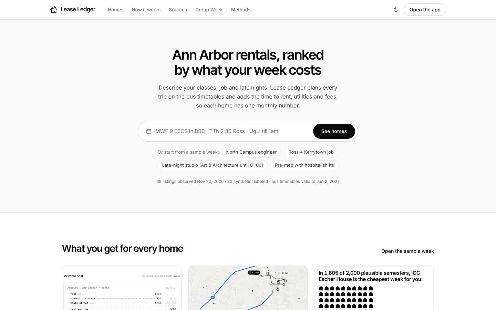

</div>

---

## Contents

- [The problem](#the-problem)
- [What it does](#what-it-does)
- [Videos](#videos)
- [Screenshots](#screenshots)
- [How it works](#how-it-works)
- [The math](#the-math)
- [Parameters](#parameters-every-home-is-ranked-on)
- [Evidence](#evidence)
- [Student interviews](#student-interviews)
- [Architecture](#architecture)
- [Data sources](#data-sources)
- [API](#api)
- [Run it locally](#run-it-locally)
- [Deploy](#deploy)
- [Testing](#testing)
- [Limitations](#limitations)
- [Repository map](#repository-map)
- [Hack the Lease submission](#hack-the-lease-submission)
- [References](#references)

---

## The problem

Every rental site shows rent, bedrooms and maybe "12 minutes to campus". Students then sign a lease and live a completely different week: an 8:30 lecture on North Campus, a lab in GG Brown, a Saturday shift in Kerrytown, and the UgLi until midnight. The cheapest-looking apartment can quietly cost hours every week on buses and on foot, plus utilities and fees nobody mentioned.

- Long commutes lower life satisfaction and are not compensated by income (the *commuting paradox*, Stutzer & Frey 2008), and commute time lowers first-year GPA (Burzacchi et al. 2024).
- Hidden fees and winter utility bills in older houses are the best-documented renter complaints in Ann Arbor.

**Lease Ledger answers one question: which home is cheapest for the week you actually live, not just by rent?**

For a North Campus engineering student, the listing with the **lowest rent ($666/mo)** costs **$1,634/mo all-in** once their week is counted. The best home for that week costs **$1,166/mo all-in**. *Lowest rent isn't the cheapest week.*

---

## What it does

| | |
|---|---|
| **Describe your week** | Type it in plain English ("MWF 9–10:30 EECS, TTh 2:30 Ross, UgLi till 1am, work Kerrytown Sat 10–4") or drag blocks on a weekly grid. An LLM parses the text into structured events. Every block keeps the exact words it came from, and a rule-based parser cross-checks it and takes over when AI is off. |
| **Route every trip** | Each trip in your week is routed on **this fall's real UM and AAATA bus timetables** and the street network, at the time of day you actually travel. Each day is chained into a tour (class → class, home only when the gap is worth it). |
| **Price your time** | Walking and waiting weigh more than riding (transport research); winter walks weigh more on snow-cover days (NOAA); you choose what an hour is worth. |
| **Monthly receipt** | Rent per person, fees, estimated utilities (low–high band), parking, travel time, late-night walking, co-op meals and work shifts. Every line is tagged *observed / estimated / assumed / computed*. |
| **Ranking + map** | Homes ranked by all-in cost, on a map with numbered price pins and your real bus and walk routes. |
| **Change one thing** | Move a class, switch to winter, change your value of time: the ranking updates instantly, with an explanation of which trips changed and why. |
| **Breakevens** | "Home B beats Home A if your time is worth less than $15.28/h", solved in closed form. |
| **How sure are we?** | 2,000 plausible semesters (unknown schedule, utilities, value of time) replayed; "In 1,605 of 2,000 semesters, this home is cheapest for you." |
| **Group Week** | Roommates enter their own weeks; it picks the apartment best for the worst-off roommate and splits rent so nobody would rather swap room and rent (envy-free). |
| **Add a listing** | Paste listing text; rent, fees, utilities and deposit are extracted with exact quotes, and anything worth checking is flagged (e.g. an application fee above Ann Arbor's $50 cap). |

---

## Videos

Every number in these clips comes straight from the engine.

| | |
|---|---|
| 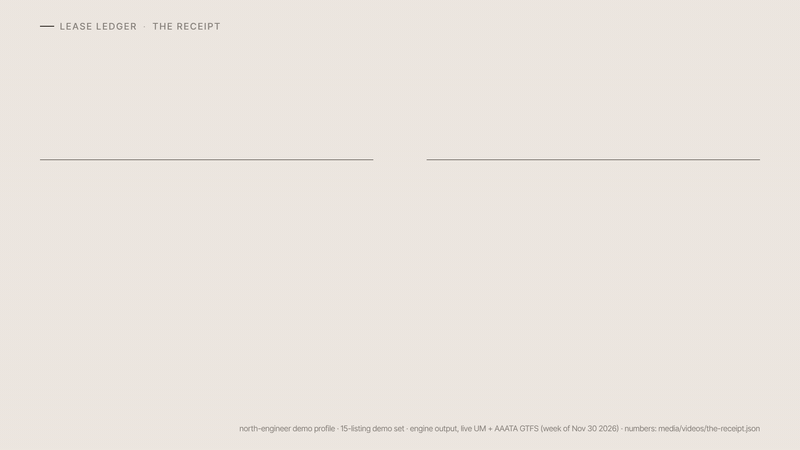<br/>**The receipt**: the full monthly calculation for the #1 home and the lowest-rent home, every formula filled in. | <br/>**The flip**: value of time swept $0 to $25/h; the two homes cross at the closed-form breakeven. |
| <br/>**One week**: a student's week fills in, then every day's tour draws onto Ann Arbor with real bus and walk legs. | <br/>**How sure**: 2,000 plausible semesters drop in and the share for #1 converges. |
| <br/>**Connection Scan**: the backward timetable scan on real UM stops; one scan serves every home. | <br/>**Seven cities**: 14,000 simulated semesters on seven real transit networks. |
| 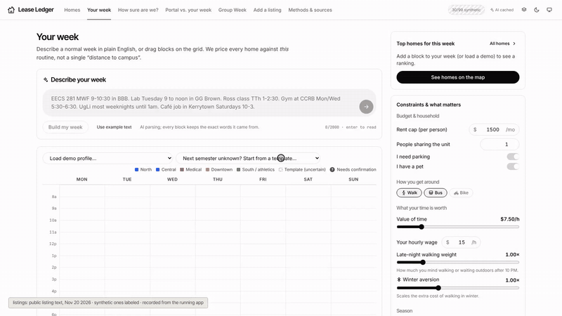<br/>**Walkthrough**: typing a week, seeing ranked homes and routes, opening a receipt, flipping the answer. | 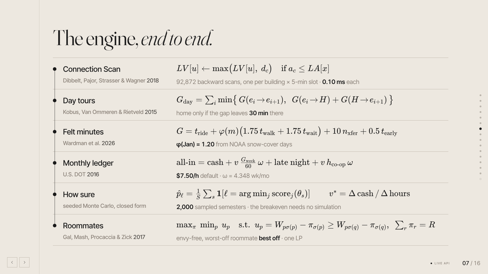<br/>**Presentation deck**: scroll-driven HTML deck with a live API demo (`presentation/`). |

---

## Screenshots

| Homes: ranked list + map with real routes | Detail: the monthly receipt |
|---|---|
| 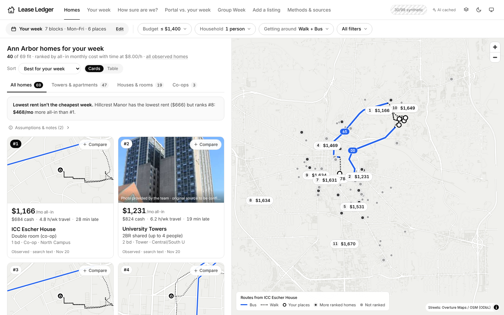 | 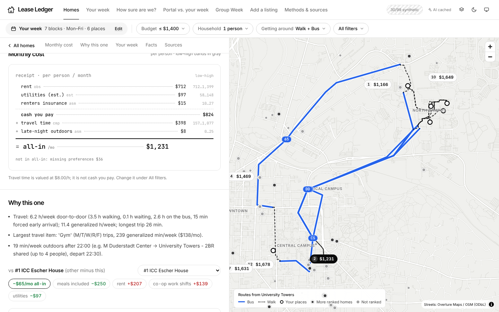 |
| **Your week: plain English → weekly grid** | **How sure are we?** |
| 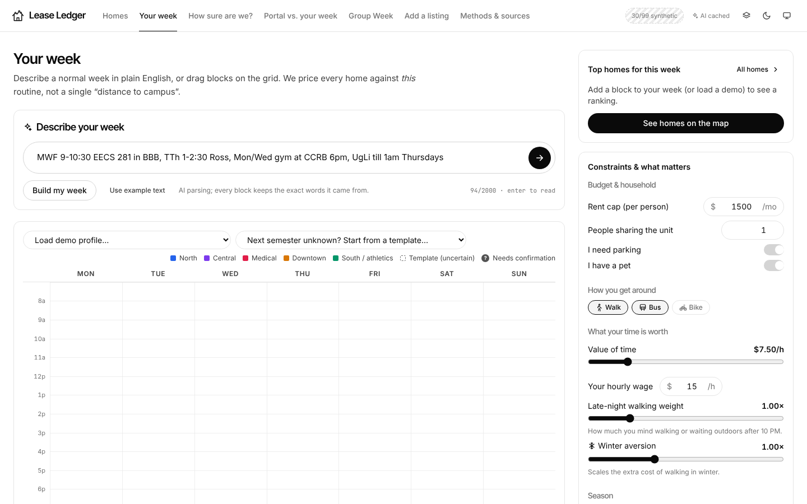 | 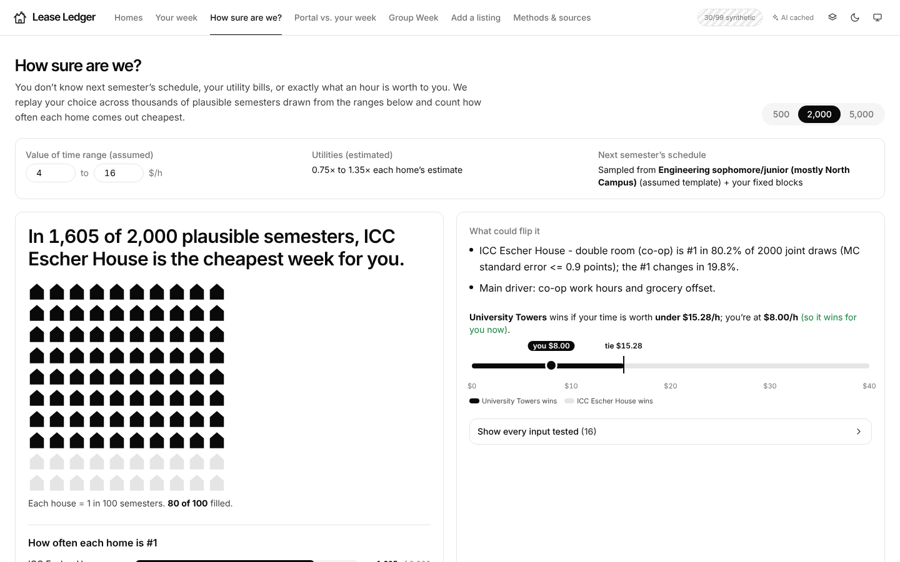 |
| **Compare two homes** | **Group Week: envy-free rent split** |
| 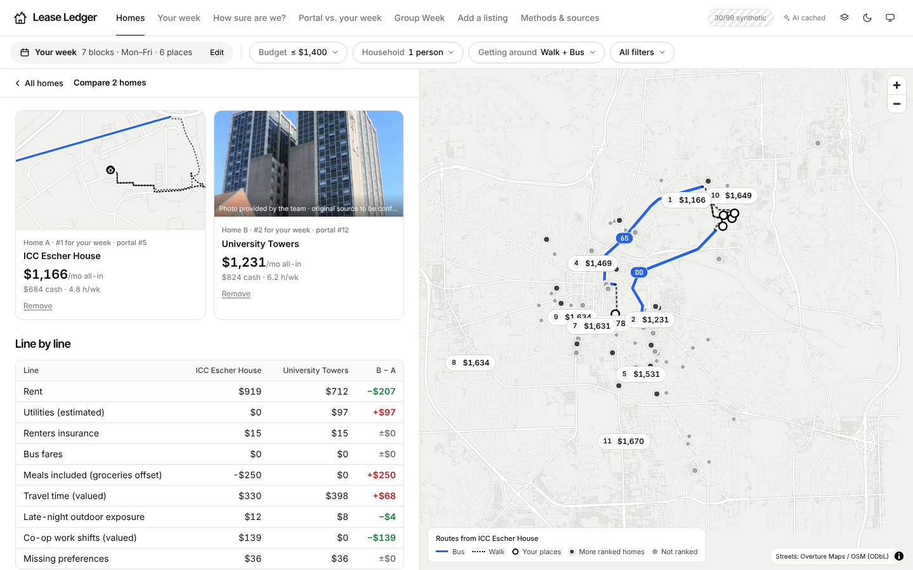 | 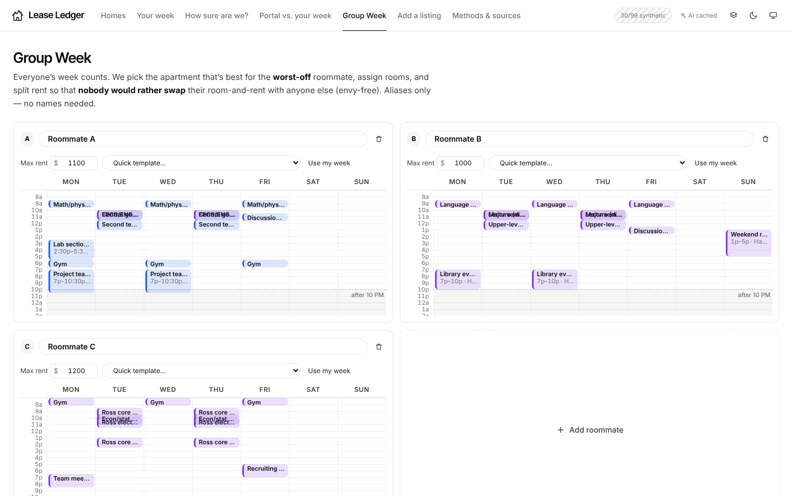 |

The app is mobile-ready and installable as a PWA:

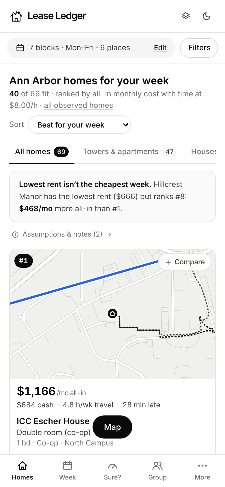 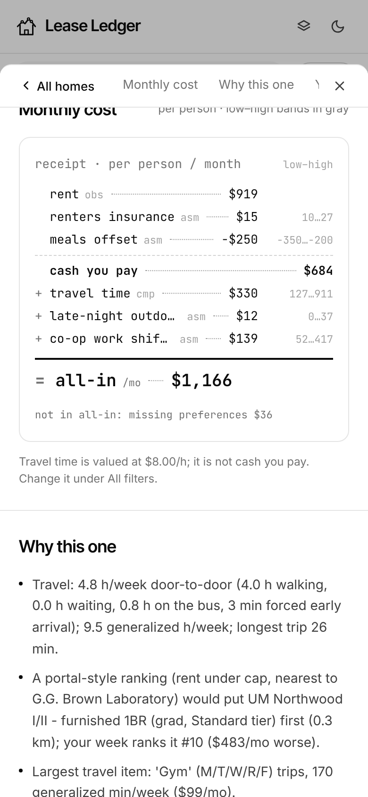 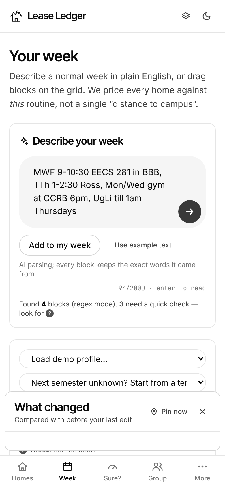

---

## How it works

```text
 "MWF 9 EECS, TTh 2:30 Ross,      ┌──────────────┐   ┌─────────────────────┐   ┌──────────────┐
  UgLi till 1am, Sat Kerrytown" ─▶│ schedule     │──▶│ day tours           │──▶│ generalized  │
                                  │ parser (LLM  │   │ (chain events; home │   │ cost per trip│
                                  │ + rules,     │   │ only if gap pays)   │   │ ride·walk·   │
                                  │ quote-checked)│  └─────────┬───────────┘   │ wait·xfer·   │
                                  └──────────────┘             │               │ early·winter │
   UM + AAATA GTFS (live fall feeds)                           ▼               └──────┬───────┘
   + Overture street network  ──▶ Connection Scan ──▶ door-to-door trip for           │
                                  (precomputed per      any home, any time            ▼
                                   building × 5 min)                         monthly ledger per home
                                                                            (rent/person, fees, utilities,
   listings (69 observed + 30 synthetic, labeled) ───────────────────────▶  time value, late night, co-op)
                                                                                      │
                     ┌──────────────────────┬────────────────────────┬────────────────┴──────────┐
                     ▼                      ▼                        ▼                           ▼
                ranking + Pareto     closed-form breakevens    Monte Carlo over          envy-free maximin
                + map + receipt      + counterfactual LP       uncertain inputs          rent split (LP)
```

---

## The math

All of it is deterministic, tested, and explained in [`ledger/engine/README.md`](ledger/engine/README.md), [`ledger/pipeline/README.md`](ledger/pipeline/README.md) and [`ledger/engine/advanced/README.md`](ledger/engine/advanced/README.md). Hand-checked worked examples are in [`ledger/engine/WORKED_EXAMPLES.md`](ledger/engine/WORKED_EXAMPLES.md).

### 1. Timetable routing: Connection Scan Algorithm (Dibbelt et al.)

The weekday timetable is a list of elementary *connections* $c = (u_c, v_c, d_c, a_c)$: depart stop $u_c$ at $d_c$, arrive at $v_c$ at $a_c$. For a target building $b$ and arrival deadline $t$, a **backward scan** over connections sorted by decreasing departure time maintains $L[s]$, the latest time you can be at stop $s$ and still reach $b$ by $t$:

$$
L[s] \leftarrow \max\big(L[s],\ d_c\big) \quad \text{if } a_c \le L[v_c] \text{ (or the trip is already boarded)}, \qquad L[s] \text{ initialised to } t - \text{walk}(s, b).
$$

Footpaths between nearby stops (≤ 300 m, including UM↔AAATA transfers) relax labels with a two-label fix so walks never chain. One backward scan answers **every** origin at once:

$$
\text{leave home } i \text{ by } \max_{s \in N(i)} \big( L[s] - \text{walk}(i, s) \big), \qquad \text{door-to-door} = t - \text{that}.
$$

Labels are precomputed for every campus building × day type × 5-minute slot (06:00–02:30); a scan takes **0.10 ms** (numba) and matches an independent time-expanded Dijkstra exactly on every test query. Return trips use the forward (earliest-arrival) scan.

### 2. Day tours

Each day's events are chained; a home visit is inserted only when it is cheaper and leaves at least 30 minutes at home:

$$
G_{\text{day}} = \sum_i \min\Big\{ G(e_i \to e_{i+1}),\ \ G(e_i \to H) + G(H \to e_{i+1}) \Big\}.
$$

### 3. Generalized ("felt") minutes per trip

$$
G = t_{\text{ride}} + \varphi(m)\,\big(1.75\,t_{\text{walk}} + 1.75\,t_{\text{wait}}\big) + 10\,n_{\text{transfer}} + 0.5\,t_{\text{early}},
\qquad
\varphi(m) = 1 + a\,(1.3 - 1)\,\frac{\text{snow-cover days}(m)}{\text{days}(m)}
$$

where $a$ is the student's winter aversion and snow-cover days come from NOAA 1991–2020 normals for Ann Arbor ($\varphi(\text{Jan}) = 1.20$).

### 4. Value of time

$$
v = 0.5 \times \text{hourly wage} \quad (\text{US DOT guidance; default } 0.5 \times \$15 = \$7.50/\text{h}), \text{ or set by the student.}
$$

### 5. The monthly ledger

$$
\text{all-in} = \underbrace{\frac{\text{rent}}{\max(h,\,\text{bedrooms})} + \frac{\text{fees}}{\text{term}} + U_m + \text{parking} - \text{meals offset}}_{\text{cash}}
\;+\; v\,\frac{G_{\text{week}}}{60}\,\omega \;+\; c_{\text{night}}\,M_{\text{night}}\,\omega \;+\; v\,h_{\text{co-op}}\,\omega,
\qquad \omega = 4.348 \text{ weeks/month}.
$$

Utilities use heating degree days × heating intensity (by building type and age) × floor area × gas price, plus electricity per person. Every input carries a low/high range, propagated to a cost band.

### 6. Breakevens (closed form)

All-in cost is linear in $v$, so the tie point between homes $A$ and $B$ is exact:

$$
v^\* = \frac{\text{cash}_B - \text{cash}_A}{\text{hours}_A - \text{hours}_B}.
$$

### 7. Counterfactuals (LP)

The smallest change in the student's priority weights that flips #1 and #2:
$\min_\delta \|\delta\|_1$ s.t. $(w + \delta)^\top (z_b - z_a) \ge \varepsilon,\ w + \delta \in \Delta$.

### 8. How sure: Monte Carlo over declared uncertainty

Sample $S = 2000$ semesters $\theta_s$ (value of time, utility prices, walk/wait multipliers, meals offset, co-op hours, and next semester's schedule drawn from program templates), with common random numbers across homes:

$$
\hat p_\ell = \frac{1}{S}\sum_{s} \mathbf 1\big[\ell = \arg\min_j \text{all-in}_j(\theta_s)\big], \qquad \text{SE} = \sqrt{\hat p_\ell(1-\hat p_\ell)/S}.
$$

### 9. Group Week: envy-free maximin rent split (Gal, Mash, Procaccia & Zick 2017)

Rooms are assigned to maximise total value (Hungarian algorithm), then prices solve

$$
\max_{\pi}\ \min_p u_p \quad \text{s.t.}\quad u_p = W_{p\sigma(p)} - \pi_{\sigma(p)} \ \ge\ W_{p\sigma(q)} - \pi_{\sigma(q)} \ \ \forall p,q, \qquad \sum_r \pi_r = R,
$$

where each roommate's valuations include their own commute cost from that apartment. If budgets make this infeasible, a slack LP finds the smallest budget relaxation ("closest to fair"). The envy matrix is verified ≤ 10⁻⁶. Not strategy-proof; stated in the app.

### 10. Advanced methods (`/api/advanced/*`)

| Method | What it answers |
|---|---|
| **EVPI** (Raiffa & Schlaifer) $\ \mathbb E_s[C(\hat h,s)] - \mathbb E_s[\min_h C(h,s)]$ | What knowing next semester's schedule before signing is worth, in $/month |
| **CVaR / minimax regret** (Rockafellar & Uryasev) | A "safe pick" that protects against bad semesters, and what that safety costs |
| **Travel-time profiles** $\tau(t)$ | Door-to-door time as a function of class start time (FIFO sawtooth); its mean $\frac1T\int\tau\,dt$ and "bus cliffs" where a 5-minute-earlier class costs a jump |
| **Sobol global sensitivity** (Saltelli) | "79–83% of the uncertainty in this decision is your value of time" |
| **Quasi-Monte Carlo** (scrambled Sobol + antithetic) | 350–17,000× lower variance for the #1–#2 cost gap at equal sample size |
| **Bayesian preference elicitation** | Learns weights from a few A-vs-B questions (information-gain question choice) |
| **Multi-apartment rent division** | Joint apartment choice + fair split (our LP; differences from Procaccia, Schiffer & Zhang 2025 documented) |

---

## Parameters every home is ranked on

| Parameter | Value | Range | Basis | Source |
|---|---|---|---|---|
| Value of time | $7.50/h | $4.80–$15/h | estimated | 0.5 × $15 wage, US DOT 2016 |
| Walk & wait multiplier | 1.75× | 1.5–2.0× | estimated | Abrantes & Wardman 2011 and later meta-analyses (US DOT implies 2.0) |
| Each transfer | +10 min | 5–18 min | estimated | García-Martínez et al. 2018 (scaled for short campus trips) |
| Forced early arrival | 0.5× | 0.3–0.8× | estimated | Small 1982 scheduling model |
| Snow-day walk | 1.3× | 1.1–1.7× | estimated | × NOAA 1991–2020 snow-cover days |
| Late night outdoors | $0.10/min | $0–$0.30/min | assumed | no published value exists |
| Co-op work shifts | 4 h/wk | 3–6 h/wk | assumed | when a listing doesn't say |
| Meals included (co-ops) | $250/mo | $200–$350/mo | assumed | grocery offset |
| Heating gas | $1.10/therm | $0.85–$1.40 | estimated | × degree days × intensity (EIA RECS 2020) |

Ranked on **cash · weekly hours · late-night minutes · fit**, combined into one all-in dollar figure (no arbitrary normalisation). Full table with provenance: [`data/behavior/params.json`](data/behavior/params.json), [`data/costs/cost_params.json`](data/costs/cost_params.json).

---

## Evidence

### Does modelling the whole week change the decision? (Ann Arbor, real listings)

2,400 sampled semesters (8 program templates × 300), 69 observed listings, $1,400 cap, $7.50/h. 95% CIs.

| Compared with… | #1 differs | Cost of the other pick |
|---|---|---|
| Listing site (rent cap + nearest) | **96.8%** (96.0–97.4) | median $555/mo (mostly per-person rent and all-in accounting) |
| Single-destination commute filter, overall | **8.1%** (7.1–9.2) | mean $7.90/mo |
| Same, **two-anchor weeks** (classes + Kerrytown job) | **60.3%** (54.7–65.7) | mean $62/mo |
| Same, close options ($1,200–1,400 homes) | **20.9%** (19.3–22.5) | — |

**One anchor? A commute filter is fine. Two anchors? It picks the wrong home most of the time.** Valuing time is the biggest lever (value of time $0 vs $7.50 changes #1 in 62.9% of semesters); the refinements (walk/wait weights 0.6%, weather 0.4%) make the receipt precise but rarely change #1, and we say so. Details: [`analysis/evidence/`](analysis/evidence/).

### Seven cities, 28,000 simulated semesters

Each semester is 12 random candidate homes plus a random routine, evaluated on that city's real transit network. "Closest to campus" vs the full-week optimum (travel-only objective outside Ann Arbor):

| City | Pick differs | Mean time lost per semester |
|---|---|---|
| San Francisco | 51% (49–53) | 13.3 h (12.4–14.2) |
| Ann Arbor | 45% (43–47) | 15.4 h (14.2–16.7) |
| Boston / Cambridge | 45% (43–47) | 8.4 h (7.8–9.1) |
| Austin | 44% (41–46) | 11.4 h (10.5–12.3) |
| New York City | 41% (38–43) | 15.0 h (13.0–17.0) |
| Champaign-Urbana | 33% (31–35) | 6.2 h (5.6–6.9) |
| Princeton | 29% (27–31) | 6.6 h (5.8–7.5) |

Ann Arbor with real rents: the cheapest-rent pick differs from the best all-in pick in 35% of futures, costing $45/mo (40–51). Methods and caveats (synthetic routines, one representative weekday, some feeds latest-valid rather than current): [`analysis/multicity/METHODS.md`](analysis/multicity/METHODS.md).

### Validation

- All **11/11** bus legs checked match the GTFS timetable exactly (independent parser).
- Connection Scan matches an independent time-expanded Dijkstra on every test query.
- Every ledger line for three homes was recomputed by hand from raw inputs; all match to the cent.
- A pre-demo smoke test replays the demo against the live API: **35/35** checks.

---

## Student interviews

**16 University of Michigan students** were interviewed on Nov 20, 2026 (FaceTime and in person). The questions are in [`execution/feedback-brief.md`](execution/feedback-brief.md); coding is in [`analysis/feedback/`](analysis/feedback/), and the collection method is in [`PROVENANCE.md`](analysis/feedback/PROVENANCE.md).

| Finding | n = 16 |
|---|---|
| Would change their decision (rated 4–5) | **10 of 16** |
| Most useful | receipt 10 · map routes 8 · breakevens 5 · how-sure 3 |
| Most wanted | real photos 8 · availability 4 · landlord quality 4 |
| Want hours and dollars shown separately | 6 of 16 |
| "Would change decision", for those who accept valuing time vs skeptics | **4.45 vs 2.0** |

Biggest product takeaway: valuing time in dollars is the main barrier for budget-first and car-first students, which points to a "cash + hours" view next to the all-in number.

---

## Architecture

| Layer | Tech | Where |
|---|---|---|
| Routing pipeline | Python, numpy, numba, pyarrow; GTFS (UM + AAATA), Overture Maps streets | `ledger/pipeline/` |
| Decision engine | numpy, scipy (HiGHS LP, Hungarian), Pydantic contracts | `ledger/engine/`, `ledger/schemas.py` |
| API | FastAPI, response caching, startup warm-up, low-memory mode | `ledger/api/` |
| AI parsing | Groq-hosted open-weight models (gpt-oss-20b → 120b) with strict JSON schema, exact-quote verification, rule-based fallback, offline cache | `ledger/ai/` |
| Web app | React + TypeScript + Vite + Tailwind, MapLibre (offline basemap), PWA | `web/` |
| Presentation | Vite + TypeScript scroll deck, KaTeX, live API with snapshot fallback | `presentation/` |
| Scraper | robots.txt-respecting, rate-limited, first-party property sites only | `ledger/scrape/` |
| Simulation | 7-city futures study | `ledger/multicity/` |
| Deploy | Docker → Render (one service: API + static app) | `Dockerfile`, `render.yaml` |

The LLM never ranks anything and never invents numbers; the whole app works with `LLM_MODE=off`.

---

## Data sources

| Data | Source | Date / validity |
|---|---|---|
| UM Blue Bus timetable | University of Michigan Transportation Services GTFS | valid 2026-08-23 → 2027-01-02 (service week of Nov 30) |
| AAATA / TheRide timetable | AAATA GTFS | valid 2026-11-15 → 2027-01-23 |
| Streets & footpaths | Overture Maps transportation theme (ODbL) | release 2026-11-18 |
| Climate | NOAA 1991–2020 normals, station USC00200230 | — |
| Listings | 69 public listings (text captured from search results, Nov 20 2026, labeled *observed · search text*) + 30 clearly labeled synthetic | prices may be stale; availability not verified |
| Utilities | DTE / EIA / MPSC rates, EIA RECS 2020 | 2025–2026 |
| Behaviour parameters | US DOT, transport meta-analyses, Small 1982 | see [`research/literature-review.md`](research/literature-review.md) |
| Other cities | Mobility Database GTFS mirrors + MTA S3; Overture Maps | see `data/multicity/PROVENANCE.json` |

---

## API

All endpoints are under `/api` and typed with Pydantic; OpenAPI is in [`ledger/api/openapi.json`](ledger/api/openapi.json).

| Endpoint | Purpose |
|---|---|
| `POST /evaluate` | Rank homes for a profile (ledger, tours, Pareto, baseline, explanations) |
| `POST /robustness` | Monte Carlo "how sure" |
| `POST /compare` · `/counterfactual` · `/diff` | A vs B, breakevens, what changed and why |
| `POST /group` | Envy-free roommate split |
| `POST /parse-schedule` · `/extract-listing` | AI parsing with quote verification |
| `POST /advanced/{evpi,risk,profile,sensitivity,elicit}` | Advanced decision math |
| `GET /listings` · `/buildings` · `/templates` · `/methods` · `/manifest` · `/health` | Data, methods, provenance |

---

## Run it locally

```bash
pip install -e .            # numpy, scipy, numba, pyarrow, fastapi, pydantic, httpx, shapely
make data                   # build routing artifacts from the GTFS feeds (~20 s)
make api                    # API on :8000 (LLM_MODE=cached by default)
make web                    # app on :5173  (landing at /, app at /app)
cd presentation && npm install && npm run dev   # deck on :4400 (T timer · S notes · A appendix)
```

Pre-demo smoke test:

```bash
PYTHONPATH=. python3 analysis/tools/demo_check.py --base http://localhost:8000
```

New GTFS feeds: drop the zips in `data/raw/gtfs_live/` and run `make data`.

---

## Deploy

**Live:** https://lease-ledger.onrender.com (Render, auto-deploys from `main`).

Render Blueprint (`render.yaml`): **New → Blueprint → this repo → Apply**. One Docker web service serves `/api/*` and the built app. It fits the free tier (512 MB) with `LOW_MEMORY=1`; use **Starter** for no cold starts. Set `GROQ_API_KEY` and `LLM_MODE=live` for live AI parsing. Full steps: [`DEPLOY.md`](DEPLOY.md).

---

## Testing

```bash
python3 -m pytest          # 199 passed, 1 skipped (routing, engine, advanced, multicity, API, AI, scraper)
cd web && npm test         # 30 passed
```

Highlights: CSA vs independent Dijkstra; trip invariants (walk + wait + ride = total, bus ≤ walk); golden ledger fixtures; breakevens exact on recompute; envy-freeness on 50 random instances; seeded Monte Carlo determinism; quote-verification rejects fabricated quotes.

---

## Limitations

- Listing prices come from public listing text captured on Nov 20, 2026, and may be stale; availability is not checked. Synthetic listings are labeled everywhere.
- One representative service week; no real-time bus delays.
- Value of time, late-night cost, co-op hours and meals offset are assumptions with ranges, all adjustable.
- Outside Ann Arbor the simulation is travel-only (no rents), with synthetic routines.
- The roommate split is envy-free but not strategy-proof.
- Interviews are a 16-person convenience sample: directional, not representative.

---

## Repository map

```text
ledger/          schemas, routing pipeline, decision engine (+ advanced), API, AI parsing, scraper, multicity
web/             React app, landing page, PWA, design docs, screenshots
presentation/    HTML deck and slide screenshots
media/           explainer videos (MP4 + posters + provenance JSON) and generator scripts
analysis/        evidence studies, multicity study, interview coding, experiments, tools
data/            GTFS feeds, streets, NOAA, listings, costs, templates, behaviour parameters
research/        literature review, market research, competitive analysis, interview protocol
concepts/ architecture/ decisions/ execution/   design process, plans, demo script, judge Q&A
```

---

## Hack the Lease submission

| | |
|---|---|
| **Event** | Hack the Lease 2026, University of Michigan (Ann Arbor), Nov 19–20, 2026 |
| **Challenge** | *Find the apartment that fits you*: help students identify, compare or make better-informed housing decisions based on their self-described needs and routines |
| **Team** | Dhruv Hegde (dhegde@umich.edu) |
| **Live product** | **https://lease-ledger.onrender.com** · app: https://lease-ledger.onrender.com/app |
| **Decision supported** | Which home is cheapest for *your week* (rent, fees and utilities plus the time your schedule spends getting around), and how sure that answer is |
| **Decision sensitivity** | Live: value of time $8→$20/h flips #1; adding a Tue/Thu hospital shift flips #1; excluding co-ops flips #1 |
| **Technical execution** | GTFS Connection Scan routing, decision engine, 229 automated tests |
| **Decision quality & evidence** | Provenance on every number, ablation with CIs, 7-city simulation, timetable validation, 16 interviews |

---

## References

- Dibbelt, Pajor, Strasser & Wagner (2018). Connection Scan Algorithm. *ACM J. Exp. Algorithmics*.
- Gal, Mash, Procaccia & Zick (2017). Which is the fairest (rent division) of them all? *J. ACM*.
- Procaccia, Schiffer & Zhang (2025). Multi-apartment rent division. *AAAI*.
- U.S. DOT (2016). Revised Departmental Guidance on Valuation of Travel Time.
- Abrantes & Wardman (2011). Meta-analysis of UK values of travel time. *Transp. Res. A* 45(1).
- Wardman, Chintakayala & de Jong (2016). Values of travel time in Europe. *Transp. Res. A* 94.
- García-Martínez et al. (2018). Transfer penalties in multimodal public transport networks. *Transp. Res. A* 114.
- Small (1982). The scheduling of consumer activities: work trips. *American Economic Review* 72(3).
- Stutzer & Frey (2008). Stress that doesn't pay: the commuting paradox. *Scand. J. Economics*.
- Kobus, Van Ommeren & Rietveld (2015). Student commute time, university presence and academic achievement. *Regional Science and Urban Economics*.
- Burzacchi et al. (2024). Commute time and first-year academic performance. *Studies in Higher Education*.
- Rockafellar & Uryasev (2000). Optimization of conditional value-at-risk. *J. Risk*.
- Saltelli et al. (2010). Variance-based sensitivity analysis. *Computer Physics Communications*.
- Lahdelma & Salminen (2001). SMAA-2. *Operations Research*.

Full literature review: [`research/literature-review.md`](research/literature-review.md).
